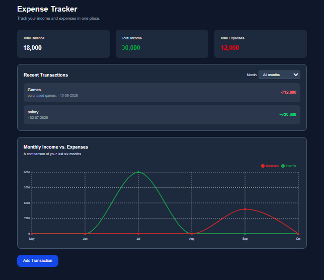

# Expenso — Expense Tracker

Keep your income and expenses organized with **Expenso**, a responsive personal finance dashboard. Add transactions, review your totals, filter activity by month, and compare income with expenses over the last six months.

<div align="center">
  <a href="https://expenso-beige.vercel.app/">
    
  </a>
</div>

## 🖥️ Preview

<div align="center">
  
</div>

## ✨ Features

- 💰 Track income, expenses, and your calculated balance.
- ➕ Add transactions with a type, amount, title, category, and date.
- 📅 Browse recent transactions and filter them by month.
- 📈 Compare income and expenses in a six-month line chart.
- 💾 Save transactions in browser `localStorage` so they remain available on that browser.
- 📱 Responsive dashboard and transaction form for mobile and desktop screens.

## 🧰 Built with

<div align="center">
  
  
  
  
  
  
</div>

## 🚀 Run locally

### Requirements

- [Node.js](https://nodejs.org/) (LTS recommended)
- npm

### Setup

```bash
git clone <your-repository-url>
cd Expenso
npm install
npm run dev
```

Open [http://localhost:3000](http://localhost:3000) in your browser.

## 📜 Available commands

| Command | Description |
| --- | --- |
| `npm run dev` | Start the local development server |
| `npm run build` | Create a production build |
| `npm start` | Serve the production build |
| `npm run lint` | Run ESLint |

## 🗂️ Project layout

```text
src/
├── app/
│   ├── layout.tsx
│   └── page.tsx
├── components/
│   └── TransactionForm.tsx
└── types/
    └── transaction.ts
public/
└── expenso-dashboard.png
```

## 💡 Data and privacy

Transactions are stored in the browser's `localStorage`. They are specific to the browser and device being used; they do not sync between devices and are not backed up to a server. Clearing the browser's site data will remove saved transactions.

## 🌐 Live demo

Try Expenso at **[expenso-beige.vercel.app](https://expenso-beige.vercel.app/)**.
